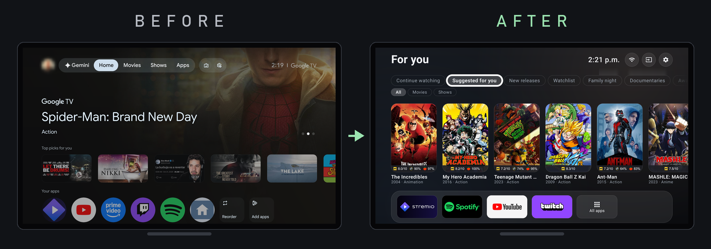
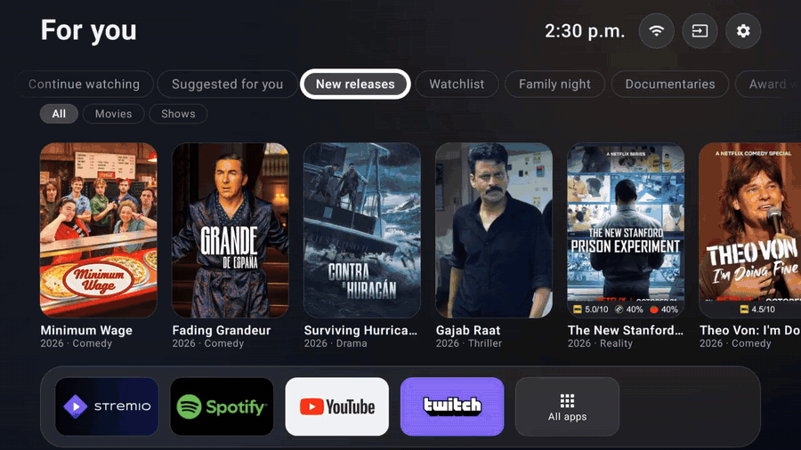

# Stremio TV Home

Make Stremio the center of your TV: your own Trakt lists inside Stremio, and a clean Android TV /
Google TV home screen built around them. No server to run, no subscriptions, set up by your own coding
agent (Claude Code or similar) or by hand.

It comes in two parts:

1. **Your Trakt lists in Stremio** (available): a list-only Stremio addon built from your own Trakt
   account, refreshed every 3 hours by a free GitHub Actions job and served from your own free Cloudflare
   account at a private link. Your watchlist, Trakt's recommendations for you, Smart lists such as
   "everything on Netflix in my country", your own lists and the ones you like, as rows in Stremio on your
   phone, computer and TV. Titles that aren't out yet are left out. [How it works](lists/README.md)
2. **TV Home** (coming next): a home screen for Android TV / Google TV that replaces Google's
   suggestions with tabs from your lists (one per streaming service, with a Movies / Shows filter),
   Stremio's Continue watching, YouTube recommendations, the Twitch channels you follow that are live,
   your apps and inputs, and a PIN lock for YouTube that never blocks the remote. It keeps Google's
   launcher installed, so Cast and the remote's buttons keep working.

TV Home on Google TV. The tab names are examples: your tabs are your own
lists.

## Set it up

**With Claude Code** (or another agent that can run commands): paste [PROMPT.md](PROMPT.md). It checks
your tools, asks which lists you want, creates your private GitHub repo and tells you exactly what to do on
trakt.tv and Cloudflare. You type your keys yourself, in a terminal of your own, so they never pass
through the agent.

**By hand:** follow [lists/README.md](lists/README.md), about 25 minutes.

You need a free [Trakt](https://trakt.tv) account (Trakt asks for a verified GitHub account before you
can create the API app the job signs in with), a free GitHub account, a free Cloudflare account, and
Stremio.

## Privacy

Your lists are served from your own Cloudflare account at a private link: an address with a long random
key in it, which nothing links to. Anyone who has the link can see the lists you include, private Trakt
lists among them (yours, and private lists you liked), so keep it to yourself; a new one takes one command.
Only catalog data is served (list names, titles, years, genres, descriptions, posters), never anything else
from your account. Your Trakt sign-in and Cloudflare token stay in your builder repo's secrets and Actions
cache, so that repo must stay private, and the job only reads your lists from Trakt.

## Questions and problems

Open an [issue](https://github.com/carcamods/stremio-tv-home/issues). Help is best effort. Never paste a
token, key, Client ID or your private link into an issue. The job's log contains none of them, but it
names your lists: check it before you quote it.

## Credits

Inspired by [Clean Your TV](https://github.com/Gathin23/cleanyourtv), which showed that a coding agent
can clean up a TV safely, step by step. This project uses the [Trakt API](https://trakt.tv), Stremio's
public addon format, posters from [RatingPosterDB](https://ratingposterdb.com)'s free tier and Cloudflare's
free plan, and is not affiliated with Stremio, Trakt, RatingPosterDB, Cloudflare or Google. It lists titles and posters
only and provides no video.

MIT licence.
